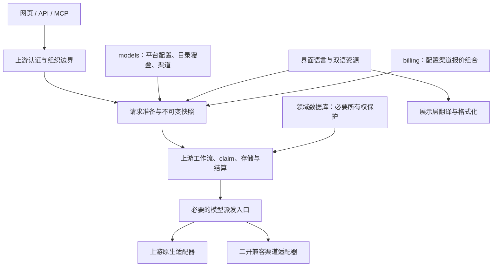

# 二开隔离与上游复用重构计划

日期：2026-11-15。状态：此前局部结构收口与已记录验证完成，整体收敛未完成。B2 已正常提交；B1 未通过并撤出，按用户决定保留显式翻译。C 已正常提交为 `5b99a43a8` 并整合固定 U；D 已完成认证、动态预算、动态目录、视觉策略与样例翻译五个单职责批次。I 为 `3f09e2b42`，源码 R 为 `f88e9d9b1`。实际退出、全域保留原因和验证见[实施结果](fork-isolation-results-20261115.md)；40 节点同步与测试数不代替结构收益，未来上游 V 的冲突下降仍未验证。

用户进一步明确要求做减法，后续优先级修正如下：

1. 清理已保存在 Git 中的历史机器台账、日志和回放材料；保留当前规则、需求、结论及 [历史取回入口](history-archive.md#records)，不再提交逐路径全量副本。
2. 生产代码先收敛文本/图片渠道重复的管理生命周期，使已有状态、保存和缓存实现实际退出；审查范围约 5,689 行，不等于可删除行数。没有旧实现退出和实际净减量，不采用新的通用封装。
3. 暂停图像执行 facade 与路由白名单适配候选；工作流保护、旧快照兼容及数据库迁移仅在证明重复或兼容对象已退役后删除。测试、双语资源和 Drizzle 快照不按体量直接裁掉。

固定 `main → c572b906d` 的 +406,344 行中，说明/审查材料占 228,549，测试/夹具占 87,752，生产源码占 39,580，数据库快照占 30,019，双语资源占 15,188，其余为配置及工具。分类互斥，不能把文档清理、生产净减量和上游原文件退出混作同一个成绩。以下保留初稿与历史试点口径。

试点结果、反例、验证边界与冲突对照见 [B1/B2 实施记录](fork-isolation-pilots-20261115.md)；C 的固定起点、兼容覆盖与实施门槛见 [2026-11-15 上游合入记录](upstream-merge-implementation-20261115.md)。下文的 B/L/U、初始差异和历史实测保留原始口径，不随实施移动分母。

目标是让现有功能持续跟随上游时，需要人工处理的重叠更少、更容易理解。二开目录数量、helper 数量、台账完成率和测试总数都不能代替这个目标。

本计划调整后续结构工作的顺序与验收方式；既有业务约束、可靠性保证、暂缓决定和历史证据继续有效。历史 P3 的完成结论已撤回，见[冲突实测](p3-conflict-assessment-20261115.md)，本文件不覆盖原始记录。

2026-11-15 用户进一步确认不需要额外增加的 Storyboard 启动保护，授权恢复上游。该启动 journal、自动重投及配套原子设置协议已撤销，实际范围与验证见[后续收口 H 节](fork-isolation-node26-followup-20261115.md#h撤销额外启动恢复回归上游启动流程)。此前已实现的额外保证不能自动当作必须保留的需求；后续仍以减少上游接入和用户确认范围为准。

## 1. 初稿固定版本与初始分母

| 对象                            | 固定值与含义                                                                                 |
| ------------------------------- | -------------------------------------------------------------------------------------------- |
| B：已合入上游基线               | `2f38e52c1548708b8a6ba30fb9c0d01cdd3896a0`                                                   |
| L：当前二开                     | `fbf4396c6c241b834cf73fd7695a0b8cfa92fe2d`，`develop` 与刷新后的 `origin/develop` 一致       |
| U：最新原始上游                 | `5da052c46d4a9ab232d865781f76e993a7667b2c`，通过上游 `ls-remote` 与成功 fetch 双重核验       |
| 当前本地 `main` / `origin/main` | 均为 `1672af37e796bdb09501e868f922678201b9c043`，比 U 少最后一个提交；不能当作完整的最新上游 |
| 共同祖先                        | L 与 U 的共同祖先为 B；U 相对 B 有 40 个第一父链节点、48 个历史提交，尚未进入 `develop`      |
| 起始工作区                      | 干净；本计划及基线材料作为新增文档单列，不进入下面的源码分母                                 |

初次通过默认 TLS 后端访问上游失败，随后使用单次命令的 `http.sslBackend=schannel` 成功；没有修改 Git 全局配置或关闭证书验证。

[本轮基线数据](history-archive.md#records 'c572b906d:docs/secondary-development/refactoring/20261115-baseline.json')记录固定 SHA、源树、统计口径、冲突路径和结果树。当前 L 相对 B：

| 范围                                        | 已有路径修改 | 新增路径 |  合计 |
| ------------------------------------------- | -----------: | -------: | ----: |
| 全仓                                        |          708 |    1,024 | 1,732 |
| `src`                                       |          661 |      579 | 1,240 |
| `src` 排除 test/spec/stories 与 `__tests__` |          524 |      317 |   841 |

最后一行仍包括语言资源及生成源码，不等同于 524 处业务侵入。文档、测试、新增扩展与实际执行接缝分开评估，不按总行数决定重构优先级。

## 2. 冲突现状与前次方向偏移

本轮对 L 与 U 重新运行 `merge-tree`，结果为 **54 个冲突文件、94 个文本冲突块**。HEAD、索引和工作区未参与实际合并；该命令只写入 Git 结果树对象。

| 按路径划分       | 文件 | 文本冲突块 |
| ---------------- | ---: | ---------: |
| `src/**/ui/**`   |   19 |         35 |
| 其余非测试 `src` |   26 |         44 |
| `src` 测试       |    6 |         12 |
| E2E              |    2 |          2 |
| 构建配置         |    1 |          1 |

这是路径分组，不能据此断言全部 UI 冲突都由翻译造成，或全部服务端冲突都可用一个 context 消除。需要沿具体差异块识别原因。

历史同口径对照中，P3 前 E 对 U 是 46 文件、79 块，之后增加到 54 文件、94 块。该历史报告检查的 40 个累计上游节点没有一个文件数下降。本轮只复测当前端点，没有重跑并冒认那 40 组历史实验。

此前方向偏移有三个具体表现：

1. 把差异归属清楚、调用分类统一、测试补全当成隔离收益，但同一上游文件里的修改仍然存在。例如 `src/shots/ui/scene-group.tsx` 的翻译 Hook、菜单、提示和确认文案仍直接修改原组件。
2. 结构任务逐渐扩展为根任务所有权、失败通知、取消、素材发布等可靠性修复。这些保证应该保留，但它们增加了核心修改，不能全部登记为冲突减少。
3. 没有及时让最新上游接管重叠能力。上游已经调整审批、风格解析、分镜草图及 staleness，继续围绕旧骨架重构会制造第二次迁移。

这次每批先回答“哪个原文件的哪类二开修改将退出或缩小”，再决定是否值得实施。

## 3. 功能归属与上游接管机会

以下来自 B、L、U 的真实源码对照。它是当前主要职责的路线图，不表示 1,732 个路径已逐块重新审完。

| 能力                                                  | 当前归属与上游关系                                                       | 重构处置                                                        |
| ----------------------------------------------------- | ------------------------------------------------------------------------ | --------------------------------------------------------------- |
| 组织、邀请、角色、钱包、Stripe、兑换码、创作 API/MCP  | 上游已有                                                                 | 保留其执行与数据骨架，二开不另建一套租户或账本                  |
| 中文默认、英文切换、SSR、格式化、帮助、邮件、MCP 展示 | 二开已实现；大量组件有直接接入                                           | 保留独立资源与请求语言实例；优先验证组件源码接入能否退出        |
| 系统指令双语、任务语言                                | 二开已实现；英文 `workflow-prompts.ts` 与 B 无净差异                     | 保留正确隔离；显式 `promptLocale` 与模板选择是必要接缝          |
| 管理员默认模型、文本/图片渠道、动态绑定与配置报价     | 二开已实现；U 没有等价管理能力                                           | 保留现有领域模块，收回侵入核心估价器与静态目录的动态职责        |
| 助手审批                                              | 上游 `5603a43b3`（#2298）部分覆盖本地同根因修复                          | 采用上游新状态机，迁移本地额外校验，争取取消两套审批入口        |
| 风格解析与空白作品                                    | 上游 `e5b95c453`（#1813）已拆出 `resolve-style-source.ts` 并新增空白创建 | 沿用上游落点，不在本地再建立另一种同职责结构                    |
| 分镜草图、版本历史与精确过期原因                      | 上游 `2fd2ff48f`（#2351）、`27d8770f1`（#2346）新增能力                  | 以新骨架设计后续接入，核对 spec 版本、`liveStamps` 与 manifests |
| 原生 Gemini 大图上传                                  | 上游 `1672af37e`（#2401）新增 Files API 生命周期                         | 保留上游实现；管理员兼容渠道不是它的替代品                      |
| 根任务启动/写入栅栏、独立失败清理和通知隔离           | 当前本地有额外可靠性保证；U 未见等价实现                                 | 保留必要条件更新与 D1 batch；只在能减少重复侵入时做单职责整理   |
| 人民币售价、成本换算、全面禁止 BYOK、默认私有         | 仍为商业规划                                                             | 不混入本次保持行为的重构                                        |

审批的“部分覆盖”不能直接升级成整项删除：本地还校验 `interruptId`、`interruptedRunId`、`generation`，防止旧快照重复提交，并兼容 typed approval。上游新 helper 主要按 `toolCallId` 关联 generic interrupt。只有原有保障迁移并验证后，才能删除重复实现。

同样，上游 `d436445bc`（#2348）的“by owner”调整是版本查询索引，不是本地 workflow root ownership；不能据提交标题撤销写入保护。

## 4. 目标结构

保持一个执行骨架，二开围绕真实领域的资源、策略和适配器组织。优先复用现有模块，不先创建通用插件框架，也不把产品职责集中塞入 `platform`。

具体保留与收口边界：

- `src/ui/i18n`、`src/platform/i18n`、双语资源和中文系统模板继续各守边界。Router/根布局保留请求独立实例、SSR 序列化与恢复；不改成共享可变语言单例。
- `src/models` 继续拥有管理员配置、渠道 CRUD、目录和协议。`create-adapter.ts` 与 `image-generation.ts` 的兼容渠道早返回已经较薄，保留必要派发。
- `src/billing/configured-image-plan-billing.ts` 拥有配置渠道的组合估价；原生模型估价尽可能回归上游 `cost-estimation.ts`，不复制视频/音乐算法。
- 请求阶段冻结模型、路由、配置及凭证引用；支出步骤按既有 credentials hatch 解析秘密。语言和模型配置显式传入父子任务。
- 条件写入保护留在拥有数据的 scoped-db 模块及原子 batch 中。仅在 workflow 外包一层函数不能替代这些保证。

上述方向不要求所有原文件零 diff。鉴权组装、任务快照、协议派发、语言渲染和安全写入都有真实接缝；每处保留原因必须具体。

## 5. 实施顺序与批次

初稿采用“先验证路线，再扩大迁移”。B1/B2 已完成试验并保留 B→U 的同口径比较；当前按用户选择撤出 B1、保留 B2，进入固定 U 的保留历史整合。原试验判据继续作为结果解释依据，不再把编译期国际化作为后续 UI 迁移路线。

| 阶段                              | 工作与范围                                                                                                        | 交付及门槛                                                                     |
| --------------------------------- | ----------------------------------------------------------------------------------------------------------------- | ------------------------------------------------------------------------------ |
| A：冻结与针对性盘点               | 本轮已固定 B/L/U、全量路径分母、当前冲突结果；实施前复核漂移，补齐每项候选的完整消费链                            | 一个能力矩阵、一个接缝清单、一个验证表；复用历史证据，不重建庞大重复台账       |
| B1：UI 接入技术试验               | 已试验，存在语义反例且维护门槛未证实；运行接入已撤出，三个页面归还显式翻译                                        | 未通过，不扩大迁移；局部冲突文件下降与构建接缝抵消分别记录                     |
| B2：配置渠道估价试点              | 已提交 `3b8d8616e`；`estimatePlanCost` 与上游基线函数文本一致，两个入口的组合决策收为 billing 一处                | 124 项定向测试、类型和构建通过；40 个固定窗口冲突均未变化，仅登记结构收益      |
| C：整合固定最新上游与接管重复功能 | 独立集成分支一次整合固定 U，逐项复核兼容；先处理助手审批、上游风格解析落点、草图/staleness 与 Gemini 新能力的兼容 | 原测试与本地差异契约都保留；记录唯一 U merge，区分上游接管、兼容适配和结构收益 |
| D：同步后收口必要接缝             | 已完成 A1、M1、M2、M3、UI1，逐批正常提交；全域其它项按真实行为与删除条件保留                                      | 3 个整文件、7 个静态函数恢复 U；动态职责归已有 owner，未新建生产模块           |
| E：验收与持续同步                 | 汇总实际收益、剩余接缝和未验范围；复用既有差异报告、正常 hooks 与关键契约，最终构建/运行验收                      | 本轮不新增 CI 流水线；未来同一 V 的冲突对照仍待其出现，不把 U 的祖先零值算收益 |

B1/B2 的并行试验已经结束。主智能体统一处理 C 的索引、合并和最终验证，同一文件或共享数据资源串行执行。D 覆盖现有全部二开职责，不以当天的 54 个冲突文件作为范围边界。

### B1：原试验判据与实际决策

以下保留初稿试验设计。实际结果是未通过，用户已经选择保留显式翻译；原型归档于本地忽略目录，未纳入运行配置，详见 [试点结果](fork-isolation-pilots-20261115.md)。

首批样本明确为：静态展示 `src/ui/error/default-not-found.tsx`、历史冲突与动态通知 `src/shots/ui/scene-group.tsx`、富文本 `src/routes/_app/pricing.tsx` 中的 `Trans` 区域。当前 `scene-group.tsx` 相对 B 为 +104/-58，仍有直接翻译 Hook、菜单、属性及异步提示接入，本轮有 1 个冲突块；它适合验证真实退出收益。`src/shots/ui/scene-script-prompts.tsx` 本轮有 7 块冲突，可选受控文案区域作为复杂扩展样本，试验不拆分整个文件。

拟试方向是在构建期识别明确的展示位置，生成现有 i18next 调用；翻译键继续用英文原文，namespace、插值及富文本资源继续独立维护。原组件源码争取恢复上游写法。仓库已有 Babel AST 工具和 Vite transform 示例，但**尚不存在经过验证的国际化编译方案**。

必须同时通过：请求间语言隔离、SSR/水合一致、切换语言后的异步提示、Hooks 规则、ARIA/placeholder、富文本与用户插值保真、source map/HMR，以及 dev、Vitest、Storybook、生产构建的一致性。必须对转换后的产物做类型检查与测试，原始源码的 `tsgo` 通过不能替代这一检查；Vitest 共享转换实现，但保持自包含配置，不继承带 Cloudflare 插件的 Vite 配置。用户内容、协议值、枚举和请求字段不能被自动翻译。

上游改文案或结构后，映射失效必须显式报告；不通过 DOM 文本替换、全局 React 拦截、整页复制或猜测所有英文字符串来维持表面可用。试验还要记录规则失效数和人工修复步骤，避免把 Git 冲突藏进另一套难维护的转换规则。最小成功门槛是至少一处原翻译 hunk 实际退出，固定窗口出现可归因的冲突文件或文本块下降，新增构建接缝单列；如果只是把 Git 冲突变成规则修复，无法证明总体维护成本下降，则该路线尚未成立。

如果该路径无法证明总体收益，就保留现有显式翻译，并先与你讨论可接受的冲突边界，再决定大规模迁移；不能默认继续堆 helper，也不能承诺现有翻译机制下所有组件都能退出修改。

### B2：原退出目标与已完成范围

以下是改前问题和原目标。实际仅退出 `estimatePlanCost` 内的渠道参数链并收口组合决策；图片/Storyboard 其它渠道链仍保留，不能称 `cost-estimation.ts` 整文件恢复上游。实际六文件范围和验证见 [试点结果](fork-isolation-pilots-20261115.md)。

`cost-estimation.ts` 相对 B 为 +121/-38，包含跨多层函数传播的路由/参数及兼容渠道识别。已有 `configured-image-plan-billing.ts` 在 fresh-plan 与 Continue 中，发现计划含配置渠道时，先逐项估算原生与配置渠道 still/sheet，再清空原计数估价器对应的图像 counts，复用原 `estimatePlanCost` 计算其余部分；这是现成组合边界。

试点补全这一边界，争取撤出核心估价器的渠道分支和参数链。优先验证内置模型与配置渠道混合、参考表、未知原生价格、零价、精度拒绝、预占及失败释放；不能复制原生算法或只改 import 名。这个文件不在本轮 U 的 54 个冲突路径中，故不能预报它会降低当前冲突文件数。

### C/D：上游接管与必要残留

- 助手以 U 的审批状态和 composer gate 为骨架，将本地额外身份与重复提交保护收进一个明确入口；通过上游与本地真实 SDK 测试后，才退出重复 helper/组件分支。
- 风格解析直接采用上游 `resolve-style-source.ts` 的职责落点。草图与 staleness 围绕 U 的 spec 版本、历史及 manifests 适配，避免对旧结构先做大规模拆分。
- 静态目录实验复用 `text-model-catalog.ts`，核对动态查询、能力与预算覆叠能否退出 `models.config.ts`。当前实现使用纯 `extraModels` 参数，没有全局注册副作用；不能按不存在的问题重构。
- 语言桥接、credential resolver、compatible 派发、Workflow composition 及根写入保护，只有发现真实重复并能缩小上游接入才再整理。未发现退出路径时明确保留，不为了数量指标再加一层。

## 6. 如何证明收益，避免同步制造的零冲突

两条证据独立交付：功能保真与维护成本。测试通过只证明相应行为，不能证明冲突下降；文本冲突减少也不能证明业务兼容。

在尚未合入 U 的试点中，固定同一个 B、当前 L、候选 R 及 B→U 的全部 40 个累计主线目标，分别试合并。记录每个目标的文件数、文本块、冲突路径并集、新增/退出路径，另记原文件 diff 和必要接缝。40 个累计目标不能求和冒充独立发布窗口。

本轮效果首先与当前 **54/94** 比；历史 E 的 **46/79** 保留为纠偏总账。只比 54/94 好、尚未优于 E 时，必须注明仍未抵消前次增长，不能宣称原 P3 目标整体完成。不给未经试验的百分比承诺。

整合 U 后，U 已是祖先，直接试合并 U 得到零冲突没有验收意义。因此：

1. 保存合入前的试点对照，不能用升级后的零值覆盖它。
2. 为升级后的大批重构固定“已整合 U、尚未重构”的集成对照 I；I 与后续 R 比较实际退出的源码修改、接缝、重复决策和行为验证。
3. 后续有 U 之后的新上游 V 时，以同一个 V 分别试合并 I 与 R。没有这样的目标时，后续批次的真实未来冲突收益保持未验证，不伪造预测数据。
4. 上游覆盖替换、纯结构减少、必要可靠性改动和构建转换维护成本分别归因。增加安全保证可以有价值，但不能冒称隔离收益。

每批完成条件是：外部行为和原断言保留，预定接缝实际退出或缩小，没有复制核心或将复杂度转移到隐藏规则。纯结构批次若没有这些收益，停止扩大；已有无关问题另列，不自动进入本次前置链。

## 7. 验证与交付

按实际变动选检查，不再以大规模测试台账替代结果。优先复用现有测试：

| 变化           | 重点证据                                                                                                                                 |
| -------------- | ---------------------------------------------------------------------------------------------------------------------------------------- |
| UI 接入        | `resources.test.ts`、`rendering.test.tsx`、`use-live-translation.test.tsx`；中英并发 Workerd SSR、水合、切换语言、异步提示和用户同名内容 |
| 系统指令与任务 | prompt catalog、`llm-call-helper.prompt-locale.test.ts`、`child-snapshot-composition.test.ts`；必填语言、父子继承、协议与用户文本保真    |
| 配置渠道估价   | configured-image-plan、partition、resolution-paths、Continue/fresh-plan、原 cost-estimation；混合计价及原预占/扣费行为                   |
| 助手接管       | 上游新审批测试与本地 `assistant-approvals.test.ts`；拒绝旧身份/旧快照、错误快照重试、typed/generic、composer 恢复                        |
| 所有权与工作流 | 原 claim、取消、失败清理、发布、D1 batch 回归；不删除既有条件保护来减少 diff                                                             |
| 集成           | 定向测试、typecheck、lint、dead-code、改动文件格式、生产 build 和正常 hooks；最终根据影响选择全量检查                                    |

执行代码变更前按仓库要求检查并加载适用 intent/项目技能。函数、文件、复杂度和边界遵守当前约定；新构建转换若被采用，也不能豁免这些约束。使用本地隔离 D1/R2 与 Mock 验证，不以真实模型、真实邮件或生产部署作为本次结构试验的隐含步骤。

每批只保留简短记录：before/after、职责、退出的原文件修改、必要残留、上游复用来源、实际验证、冲突/结构收益及限制。交付时明确当前是否仍有保留的核心修改，不能用“已放扩展目录”概括兼容性。

持续守卫复用已有 `scripts/check-localization-changes.ts` 等报告，补充关键接缝及上游原断言变化检查，先校准再阻断确定错误。仅提交或 push `develop` 的 CI 触发需实际核对，不假定已有完整门禁；提交、推送、部署按后续实际授权执行。

## 8. 当前结论与下一阶段

本轮已完成初始核验与试点：B2 有明确结构收口并通过当前定向验证，40 个固定窗口冲突未下降；B1 虽使一个冲突路径退出，但端点文本块被新构建接缝抵消，且存在保真反例，未通过采用门槛。B1 的类型、构建和测试成绩不改变该结论。

用户已明确选择撤出编译接入、保留显式翻译，先同步上游并收口必要接缝。C 从 B2 正常提交 `3b8d8616e9ce6552ca175cb2db80ad58589334aa` 出发，以一次第二父提交为固定 U 的 merge 保留完整历史，按 40 项清单适配和验证；当前状态见 [合入记录](upstream-merge-implementation-20261115.md)。

保留完整功能与可靠性，不通过削减二开、丢失上游功能或隐藏冲突交付数字。实际完成合入后才更新上游基线；合入 U 后的零冲突也不能替代本计划要求的前后对照。

后续实施分开保留：[D 固定结果](fork-isolation-results-20261115.md)记录三个整文件、七个静态函数退出及 17 个领域组的保留理由；[E 后续记录](fork-isolation-node26-followup-20261115.md)记录 Node 26 复验、配置图片请求报价投影从核心净退出 31 行及本地 `develop` 落地。图片静态目录候选因公开类型漂移撤回；两处配置 loader 没有现成完整捕获服务，严格统一还需额外策略与调度，故保留薄接缝。上述取舍不扩大为整个 fork 已完成隔离，也不把尚无新上游 V 的状态算成冲突下降。
