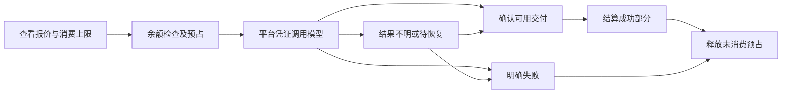

# 首期功能与业务规格

版本：0.1，日期：2026-11-07。状态：规划规格；上游复用能力与二开计划分别记录，本次仅修订文档。

本规格将 [需求清单](requirements.md) 和 [已接受的首期规则基准](confirmation.md) 细化为角色、功能、页面、流程及交付边界。涉及空间、钱包及兑换卡的口径以 2026-11-06 最新决定为准：保持上游 Organization 的邀请、切换、共享、角色和组织钱包，复用项目自带兑换卡，撤销个人人民币钱包及商业卡密改造规划。其他已确认规划继续保留；人民币模型售价如何衔接现有钱包尚待设计，不要求钱包或账本迁移。本文不构成业务代码开工指令，不声明已有同名接口、表、字段或枚举。验证场景见 [验收清单](acceptance.md)。

## 1. 首期交付目标

目标商业链路为：运营方配置平台渠道及人民币模型销售单价；用户注册或登录，在获授权的组织中使用现有兑换卡和组织钱包，查看费用并生成内容；平台按后续确定的销售结算方案核对消费，单独核算供应商成本和调用差价。组织、钱包及兑换卡属于上游已有能力，列入复用回归；人民币售价与现有钱包的衔接及其他商业二开仍属待设计、待实现规划。

正式平台面向公网，允许使用 Cloudflare 部分能力。具体托管与自建分工仍待评估；不以完整运行时迁移作为商业功能设计的前提。

## 2. 角色与权限边界

| 能力                           | 未登录访问者         | 已登录组织成员（按实际角色）                           | 平台运营管理员                       |
| ------------------------------ | -------------------- | ------------------------------------------------------ | ------------------------------------ |
| 登录及公开页面                 | 可访问明确公开的页面 | 可访问                                                 | 可访问                               |
| 组织邀请、切换、共享及角色管理 | 登录后按授权操作     | 沿用上游成员资格及角色权限                             | 平台管理身份不自动取得组织角色权限   |
| 付费生成                       | 不允许               | 使用当前获授权组织的钱包及资源，遵循适用角色与计费规则 | 创作时仍按获授权组织及实际角色处理   |
| 钱包与消费记录                 | 不允许               | 按当前组织及实际角色访问组织钱包和记录                 | 在实际运营授权内查询及有审计地调账   |
| 兑换卡兑换                     | 登录后操作           | 沿用上游规则，兑入当前获授权组织的钱包                 | 兑换仍遵循实际组织归属及权限         |
| 兑换卡管理（已有能力）         | 不允许               | 按上游实际管理权限处理                                 | 复用现有管理能力，不新增商业发卡要求 |
| 平台供应商凭证及价格           | 不允许               | 不允许查看或配置平台凭证和运营成本                     | 配置和维护，响应及日志不泄漏完整凭证 |
| 作品与素材                     | 仅明确公开分享的内容 | 按组织授权和实际角色访问、管理资源                     | 沿用实际合入的上游管理员权限机制     |
| 公开分享及撤销                 | 访问仍有效的分享     | 按组织授权和实际角色管理分享                           | 遵循实际授权范围和操作审计           |

完整保留上游 Organization 的邀请、切换、共享、角色和组织钱包，不施加一用户一空间或个人钱包限制。多租户权限隔离继续成立：普通用户按真实组织成员资格、当前组织及实际角色授权，系统管理员访问按实际合入的专门权限机制处理，不能只靠隐藏导航。默认私有规划针对未授权主体，不取消获授权组织成员的协作访问。

## 3. 首期功能清单

表中 F 编号仅用于需求跟踪，不是现有代码中的类型或接口。

| 编号 | 功能                 | 首期要求                                                                                                                 | 上游与二开关系                                                               |
| ---- | -------------------- | ------------------------------------------------------------------------------------------------------------------------ | ---------------------------------------------------------------------------- |
| F01  | 账号与组织访问       | 邮箱验证码、自主注册；付费生成要求登录，注册不自动赠送余额；保留组织邀请、切换、共享和角色权限                           | 复用认证与 Organization，按实际角色回归；不改造为个人空间                    |
| F02  | 组织钱包与消费记录   | 沿用组织钱包的余额、有效预占、可用额度及入账、消费记录，保持实际币种和计量                                               | 上游已有，复用回归；不实施个人人民币钱包或钱包、账本迁移                     |
| F03  | 现有兑换卡           | 沿用项目自带兑换卡的金额、次数、有效期、组织归属及已有管理规则                                                           | 上游已有，复用回归；不新增商业卡密、人民币档位或发卡后台要求                 |
| F04  | 模型与销售价格       | 首批围绕 fal/OpenRouter；维护上架模型、适用规格、人民币单价和价格版本                                                    | 二开计划；复用模型适配及目录，售价与现有钱包的衔接待设计                     |
| F05  | 生成与消费结算       | 展示预估和授权上限，组织钱包额度预占、按成功交付结算、结算失败幂等重试、异常核对及未消费额度释放                         | 复用工作流与预占；销售结算贯通仍为二开计划，不预设人民币账本                 |
| F06  | 凭证统一管理         | 仅平台运营方配置供应商凭证，用户不能填 Key 或走供应商授权绕过平台收费                                                    | 二开计划；改造上游 BYOK 入口、服务端选择和免扣费逻辑                         |
| F07  | 成本与经营记录       | 区分现有兑换入账、组织钱包消费记录、人民币销售金额、供应商原币种成本、人民币核算成本及调用差价                           | 二开计划；复用部分成本观测，补销售与成本边界；不新增售卡实收后台             |
| F08  | 私有素材与分享       | 默认对未授权主体私有，按组织及角色授权访问、删除和下载；主动分享及撤销按实际授权处理                                     | 二开计划；调整上游公开媒体行为，保留组织协作及文件、接口权限边界             |
| F09  | 中英文界面与账号邮件 | 默认中文，支持英文，当前浏览器记忆；现有账号邮件随发起操作时的界面语言发送，未选择时默认中文；内容和真实币种不随界面切换 | 统一翻译机制及覆盖仍按独立计划与记录验收，不因本次修订更新实施状态           |
| F10  | 公网运营与管理       | 用户启停、模型和价格、组织授权内的流水、成本、异常及调账审计；生产拓扑、持久化与恢复验收                                 | 上游管理页为复用基础；其余商业管理仍为二开计划，不包含发卡改造或售卡实收登记 |

### 功能、规则与验收追踪

保留原 F、R、D、A 编号供引用追踪；涉及已撤销个人钱包及商业卡密约束时，以 2026-11-06 修订为准，不继续作为开发门槛。

| 功能 | 需求或规则来源           | 主要验收项                                                      |
| ---- | ------------------------ | --------------------------------------------------------------- |
| F01  | R03/R04，D01/D02         | A01–A03、A29                                                    |
| F02  | R06，D01/D06/D08         | A09–A11/A13 复用回归、A12 历史风险；A16/A18/A27/A28；A17 已撤销 |
| F03  | R05，D07/D08             | A09–A11/A13 复用回归；A12 历史风险，非修复门槛；A14/A15 已撤销  |
| F04  | R07/R08，D03–D05         | A07/A08、A19/A20、A29                                           |
| F05  | R08，D06                 | A18–A27                                                         |
| F06  | R11，D03/D09             | A04/A06/A08/A29                                                 |
| F07  | R08/R10，D04/D05/D09/D10 | A16/A20/A22/A28/A33                                             |
| F08  | D11/D14                  | A03/A05、A30–A32、A37                                           |
| F09  | R09，D12                 | A34–A36                                                         |
| F10  | R12，D09/D13/D14         | A04/A28/A29、A38–A41                                            |

首期不新增通用模型调用 API、在线支付渠道、订阅套餐或提现。上游已有组织共享钱包、兑换卡、创作 API/MCP/Stripe 保留并按实际能力复用，不因旧规划裁剪；适用调用仍应遵循组织权限和计费边界。

## 4. 页面与入口规划

下表 URL 只列已核对的上游入口。规划管理功能尚无已确定路由，不虚构页面已经存在。

| 入口       | 已核对上游位置                                                                               | 本项目页面要求                                                                                                                   |
| ---------- | -------------------------------------------------------------------------------------------- | -------------------------------------------------------------------------------------------------------------------------------- |
| 登录       | src/routes/_auth/login.tsx，对应 /login                                                      | 中文默认、邮箱验证码、登录后继续原业务流程；进入获授权组织                                                                       |
| 创作及资源 | src/routes/_app 下的 studio、sequences、images、videos、characters、locations、styles 等路由 | 保留适用创作流程及组织协作；平台模型、费用展示和资源访问遵循当前组织与实际角色                                                   |
| 模型及价格 | src/routes/_app/models/index.tsx、pricing.tsx                                                | 用户只看到允许上架的能力与销售价格，不能从页面或响应拿到供应商秘密及运营成本                                                     |
| 组织钱包   | /credits 的 balance 标签                                                                     | 展示当前获授权组织的现有余额、预占及可用额度，沿用真实币种；人民币销售报价与钱包的衔接待设计；首期不展示可执行的在线支付购买流程 |
| 消费与入账 | /credits 的 transactions 标签                                                                | 按组织及实际角色展示业务类型、真实币种金额、时间、状态与相关任务；预占不冒充已消费                                               |
| 兑换卡     | /credits 的 gift-codes 标签；src/routes/gift/$code.tsx 的礼品链接                            | 沿用现有组织钱包兑换及实际管理权限、次数和有效期规则；现有管理能力不列作新增发卡项目                                             |
| 用户设置   | src/routes/_app/settings 下已有路由                                                          | 适用账号设置、组织邀请/切换/共享/角色入口及语言入口保留；用户供应商凭证配置及授权入口按禁止 BYOK 规划处理                        |
| 运营管理   | 已有 admin/usage、admin/moderation，不能视为完整商业后台                                     | 规划渠道/模型/售价、按组织及实际角色授权的账务查询、成本、异常核对和审计；不新增商业发卡或售卡实收后台；URL 与页面拆分后续设计   |

具体页面组件及接口命名属于后续设计；不因本表列出管理功能就声称其已经实现。管理员审核及作品访问沿用实际合入的上游权限机制，新增入口按对应提交评估和验证。

## 5. 关键业务流程

### 5.1 登录与组织访问

1. 用户访问公网网站，未保存语言选择时以中文展示。
2. 用户通过邮箱验证码完成注册或登录，按上游流程创建、加入或切换获授权组织。
3. 注册本身不自动赠送余额；加入现有组织后按授权访问该组织的钱包和已有额度，不因此另建个人钱包。
4. 组织邀请、共享和角色管理沿用上游；付费调用在服务端确认真实成员资格、当前组织和实际角色，不采信客户端伪造的组织、资源或钱包身份。

### 5.2 现有兑换卡复用

1. 沿用项目已有兑换卡及管理入口：单张创建支持配置总兑换次数上限；批量创建支持 1–500 张，每码最大兑换次数为 1。按实际权限复用，不新增商业发卡流程。
2. 已登录用户在当前获授权组织兑换；同卡的组织已兑约束、配置的总次数上限和有效期沿用现有规则，不统一改成全平台单次或默认永久有效。
3. 兑换按现有金额及计量入账该组织钱包，显示实际结果；重复提交、组织切换、额度耗尽、无效或过期等按现有实现回归。
4. 按实际规则安排现有兑换与入账回归；A12 核销入账故障一致性仅保留为历史未验证风险，不作为本轮修复或交付门槛。发现差异据实记录，不自动扩展修复范围，也不宣称新增商业卡密已实施或验收通过。

现有兑换入口为 /credits?tab=gift-codes 和 /gift/$code。规则依据 [兑换卡服务端入口](../../src/billing/gift-tokens.fn.ts) 及其调用实现：兑换入账当前活动组织，钱包按 organizationId 归属；amountUsd/amountMicros 分别为 USD/微美元。同卡同组织受唯一兑换约束，总次数和可选有效期沿用上游；[兑换结果逻辑](../../src/billing/gift-redeem.ts) 区分本人已兑和同组织已兑。上游已有能力不算本项目新增；自定义人民币档位、商业发卡生命周期及售卡实收后台均不再列入本轮要求。

### 5.3 报价、生成与结算

以下为保留的二开规划。人民币销售价格与现有组织钱包的币种、计量和扣费如何衔接尚待设计，不以新建个人人民币钱包或迁移现有账本为前提。

1. 从允许上架的模型和规格中选择创作能力，读取适用人民币销售价格。
2. 展示费用预估、本次授权消费上限及计费单位；不能把预估写成最终扣款。
3. 用户点击生成，服务端确认当前组织及实际角色，锁定本次价格和授权范围；按待设计的衔接方案检查组织钱包可用额度并预占。
4. 使用平台凭证发起供应商任务，记录实际渠道及任务身份；轮询和结果核对沿用对应身份。
5. 将成功结果保存为可使用交付；内部重试、状态查询及恢复步骤不能重复扩大同一交付的用户收费。
6. 按锁定价格和实际用量计算成功的可计费部分；人民币销售金额与组织钱包记账的对应关系按后续设计执行，供应商成本及估算/核实状态单独记录。
7. 结算失败保留可核对依据并支持幂等重试，不重复扣费；释放未消费预占，按组织权限展示相关任务、已消费与仍待核对的部分。
8. 余额不足或没有可用价格时不发起新的付费调用；不允许并发任务重复占用同一额度。

“可计费部分”指销售规则明确覆盖的服务交付，不等于每个内部工作流步骤。脚本、图片、视频等如何映射计费单位必须在模型规格与报价设计中写清楚，不能让用户为不可见的技术重试重复付费。

### 5.4 失败、取消及状态不明

| 情况                                   | 当前规则与处理要求                                                             |
| -------------------------------------- | ------------------------------------------------------------------------------ |
| 供应商调用前拒绝、余额不足或配置不可用 | 不发起对应付费调用，不产生该交付的成功消费                                     |
| 明确失败                               | 该失败部分不向用户收费，释放其未消费预占；供应商仍收费时记为平台成本           |
| 前面步骤成功，后面失败                 | 对已经成功且符合价格规则的交付结算，不因整条流程失败退款全部成功步骤           |
| 调用发出前取消                         | 停止未发出的部分，释放其未消费预占                                             |
| 调用发出后取消                         | 核对实际结果与交付状态后结算，不能直接认定没有消费                             |
| 超时、断线、重放、结果不明             | 进入待核对；不能直接重发、重复扣费或承诺已经退款                               |
| 供应商成功但存储/落库异常              | 进入恢复或核对流程，不能仅凭供应商成功把尚不可用结果冒充已交付，也不能重复结算 |
| 结算写入失败                           | 保留任务、价格及预占依据，允许幂等重试与异常核对，不重复扣费或丢弃待结算记录   |
| 授权上限不足以覆盖后续调用             | 停止发起新的付费调用，不自动透支或追加授权外扣费                               |

异常列表需要回答“谁、哪个任务、涉及什么预占和成本、目前何种结果、下一步由谁处理”。具体状态枚举和自动核对时限由技术方案定义，不能把下列示意图当成现有状态字段。

### 5.5 调价、模型下架和凭证更新

- 调价形成可追溯的新版本；已经获授权的任务按其价格快照结算，不追随新报价。
- 下架阻止新的用户付费任务；已提交任务仍需跟踪和结算，不丢弃任务身份或预占。
- 平台凭证更新与用户凭证禁用是两件事；所有适用入口都不能重新回到上游 BYOK 免扣费路径。
- 成本汇率版本与销售价格版本分别保留；供应商最终成本到达后可以补核对，不能覆盖成用户销售价或随意追改消费。

### 5.6 素材、下载及分享

- 通过界面、直接 URL、适用 API/MCP 或下载入口访问资源时，都按组织授权和实际角色校验，默认私有不阻止获授权的组织协作。
- 分享由有权的组织成员操作，只公开明确选择的内容，不自动公开整个组织、未选历史版本、账单或供应商任务信息。
- 撤销分享后阻止后续未经授权的访问；已经被访问者下载的副本不承诺远程收回。
- 给供应商的素材访问按必要范围处理；允许外部 AI 获取必要输入，不等于将用户全部素材公开。
- 视频导出按实际选定的生产渲染服务验证；本地预览没有渲染器，不能据此声称公网导出已可用。

## 6. 金额、账务与经营口径

| 业务概念                 | 需求口径                                                                                   |
| ------------------------ | ------------------------------------------------------------------------------------------ |
| 组织钱包余额             | 沿用上游组织钱包的实际币种、计量和余额语义，不新增个人人民币余额                           |
| 有效预占                 | 组织钱包中尚未结算或释放、已承诺给任务的额度，计量沿用现有钱包                             |
| 可用额度                 | 组织钱包余额扣除有效预占，供获授权成员发起新任务；不能负数或重复承诺                       |
| 组织钱包消费记录         | 保留现有账本的真实币种、计量、任务和组织归属，不直接视作人民币销售金额                     |
| 人民币模型售价与销售金额 | 按模型/规格及适用版本维护人民币单价与销售金额；如何衔接现有钱包、预占和结算待设计          |
| 现有兑换卡金额与入账     | 沿用上游实际规则和计量，入账当前获授权组织的钱包；不新增人民币面额、售卡实收登记或发卡后台 |
| 供应商成本               | 保留原币种、使用依据、渠道和任务关联；预估与已核实分开                                     |
| 人民币核算成本           | 原币种成本按适用版本汇率换算的核算值，与组织钱包币种分别记录                               |
| 调用差价                 | 人民币销售金额减相应人民币核算成本，不自动称为净利润，也不直接拿钱包原始数值相减           |
| 人工调整                 | 在实际授权范围内追加有原因、操作者和可核对依据的账务记录，不修改原流水来掩盖历史           |

本表是业务概念，不指定新建表或字段，不要求钱包、账本或存量金额迁移。人民币销售金额与现有钱包的衔接方案尚未确定，不能只改货币符号或把存量微美元解释成人民币。模型售价、成本换算及细额的精度、汇总和舍入规则需另行设计，现有钱包保持真实金额语义。

## 7. 中英文覆盖要求

本模块 F09 已被指定为第一阶段优先项；编号保持不变，具体覆盖顺序和独立验收见 [中文阶段计划](localization-plan.md)。

- 统一导航、登录、钱包、兑换、模型/价格、生成操作、任务状态、资源管理及运营后台的静态界面文案。
- 同时盘点空状态、弹窗、表单校验、提示、错误、日期时间和系统提供的展示说明，避免只翻译菜单。
- 默认中文，显式切换后当前浏览器保留选择；刷新、直接打开子页面和服务端首屏保持一致。
- 现有账号相关邮件纳入第一阶段，覆盖主题及正文等现有文案；语言取发起操作时的界面语言，未选择时默认中文，异步发送沿用发起时的语言。实际模板以代码盘点为准，不新增邮件类型。
- 界面语言不改变金额的真实币种和计量：现有组织钱包及兑换卡沿用原口径，人民币模型售价仍为 CNY；不自动翻译用户原文、剧本、模型提示词或生成结果。
- 模型名、供应商名和必要技术规格可保留原名，不能把未覆盖的普通英文提示当作专有名词。
- 系统长文、帮助和条款等内容逐项盘点翻译覆盖，记录版本；未完成部分如实记录，不因导航已翻译声称全站完成。其他邮件和 CLI/MCP 文案单独记录后续范围。

## 8. 公网运行与 Cloudflare 边界

| 职责                  | 当前上游基础                             | 本轮要求                                                    |
| --------------------- | ---------------------------------------- | ----------------------------------------------------------- |
| Web、认证和服务端入口 | TanStack Start 与 Cloudflare Worker 入口 | 验证公网域名、HTTPS、登录及权限，不预设必须改成普通 Node    |
| 数据及钱包            | D1、Drizzle、ScopedDb                    | 选择生产数据承载方式，验证持久化、账务一致性与备份恢复      |
| 媒体存储              | R2 绑定及媒体路由                        | 选择实际存储方式，满足默认私有、授权下载与受控分享          |
| 持久任务              | Cloudflare Workflows                     | 评估保留或替代，必须保留持久化、恢复、重放与幂等语义        |
| 实时及其他账户级协调  | Durable Objects 等上游依赖               | 按采用渠道与开放功能验证，不把普通后台 Promise 当成等价替代 |
| 视频导出              | 上游生产渲染容器                         | 纳入所开放功能的端到端验证；部署方式待选型                  |

本表只列仓库依赖与需求，不声明某个 Cloudflare 套餐、当前价格或容量已经评估。具体保留哪些服务、自建哪些服务，以及访问区域、成本与运维方式，待资源事实补齐后形成技术方案。

## 9. 建议的后续设计与交付顺序

1. 中文界面第一阶段：覆盖现有页面的中文默认、中英文切换、语言记忆、动态提示及独立验收；本阶段不改变金额语义或账务行为。
2. 商业方案与最小纵向链路：明确人民币模型售价与现有组织钱包的衔接、组织角色授权及销售规则；复用现有兑换卡，设计模型配置、报价、生成、结算和成本核对，不增加个人钱包或商业发卡改造。
3. 覆盖其他首期创作入口、任务恢复、私有媒体及运营管理；新增页面接入统一翻译，首期范围不因分步交付自动缩减。
4. 按验收清单执行商业及生产环境验证，明确真实模型费用授权、环境和未覆盖项。

该顺序是未来工作规划，不是当前已经开始编码。技术实现还需遵守工作流快照、渠道标记、ScopedDb、服务分层及本仓库代码质量约束。

扩展方式按 [上游兼容约束](extension-policy.md) 设计：代码风格一致，优先公开接口、独立模块、扩展目录及薄桥接，避免无关核心和数据结构修改；必要侵入需列出原因、最小范围、影响、验证及升级冲突点。

## 10. 当前未补齐项与进入实施前的产物

- 事实输入：现有云/服务器资源与预算、目标访问区域、初期规模、真实存量账务、发信及供应商账号可用性。
- 运营配置：首批模型与规格、实际售价、汇率、管理员、域名和产品名称；模型没有完整价格不向用户开放。
- 设计产物：页面与接口清单、人民币售价与现有组织钱包的衔接方案、必要数据设计、金额及舍入方案、计费交付边界、状态与恢复方案、部署选型及翻译覆盖清单；不将钱包或账本迁移列为既定工作。
- 实施前需明确业务代码开工范围；当前保持计划阶段，不配置真实密钥，不触发模型消费或生产部署。
