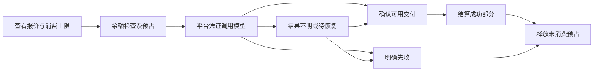

# 首期功能与业务规格

版本：0.1，日期：2026-11-03。状态：规划规格，尚未实现。

本规格将 [需求清单](requirements.md) 和 [已接受的首期规则基准](confirmation.md) 细化为角色、功能、页面、流程及交付边界。它不构成开工指令，不声明已有同名接口、表、字段或枚举。验证场景见 [验收清单](acceptance.md)。

## 1. 首期交付目标

跑通一条可核查的商业链路：运营方配置平台渠道和模型售价，发行卡密；用户注册、兑换人民币余额、查看费用并生成内容；平台结算用户账单，单独核算供应商成本和调用差价。

正式平台面向公网，允许使用 Cloudflare 部分能力。具体托管与自建分工仍待评估；不以完整运行时迁移作为商业功能设计的前提。

## 2. 角色与权限边界

| 能力                 | 未登录访问者         | 普通用户                   | 平台运营管理员                         |
| -------------------- | -------------------- | -------------------------- | -------------------------------------- |
| 登录及公开页面       | 可访问明确公开的页面 | 可访问                     | 可访问                                 |
| 付费生成             | 不允许               | 使用本人余额和资源         | 本人创作仍遵循适用计费规则             |
| 钱包与消费记录       | 不允许               | 仅本人钱包                 | 在运营权限内查询及有审计地调账         |
| 卡密兑换             | 登录后操作           | 兑入本人钱包               | 兑换也按归属规则处理                   |
| 发行、导出及作废卡密 | 不允许               | 不允许                     | 允许，记录操作者                       |
| 平台供应商凭证及价格 | 不允许               | 不允许查看或配置凭证和成本 | 配置和维护，响应及日志不泄漏完整凭证   |
| 用户作品与素材       | 仅明确公开分享的内容 | 本人资源及获授权内容       | 管理员身份默认不提供跨用户作品浏览能力 |
| 公开分享及撤销       | 访问仍有效的分享     | 管理本人的分享             | 平台管理身份不自动替代作品所有权       |

个人空间优先复用上游默认 Team；首期不开放成员邀请、共享钱包、多团队切换或跨用户转账。权限必须在服务端成立，不能只靠隐藏导航。

## 3. 首期功能清单

表中 F 编号仅用于需求跟踪，不是现有代码中的类型或接口。

| 编号 | 功能                 | 首期要求                                                                                                             | 上游与二开关系                                     |
| ---- | -------------------- | -------------------------------------------------------------------------------------------------------------------- | -------------------------------------------------- |
| F01  | 账号与个人空间       | 邮箱验证码、自主注册、独立空间；付费生成要求登录，注册不自动赠送余额                                                 | 复用认证与默认 Team，调整匿名付费和协作入口        |
| F02  | 人民币钱包           | 展示余额、有效预占和可用余额，支持查看入账与消费记录                                                                 | 复用账本基础，实施真实币种边界调整                 |
| F03  | 商业卡密             | 自定义面额及 50/100/200/500 元预设；全平台单次兑换，默认不过期；批量、导出、查询、未兑作废                           | 复用礼品码入口，补核销入账一致性和生命周期         |
| F04  | 模型与销售价格       | 首批围绕 fal/OpenRouter；维护上架模型、适用规格、人民币单价和价格版本                                                | 复用模型适配及目录，不把供应商成本表直接当销售价格 |
| F05  | 生成与消费结算       | 展示预估和授权上限，余额预占、按成功交付结算、异常核对及未消费额度释放                                               | 复用工作流与预占，贯通销售单价和幂等               |
| F06  | 凭证统一管理         | 仅平台运营方配置供应商凭证，用户不能填 Key 或走供应商授权绕过平台收费                                                | 改造上游 BYOK 入口、服务端选择和免扣费逻辑         |
| F07  | 成本与经营记录       | 分开记录售卡实收、兑换额、用户消费、原币种成本、人民币成本及调用差价                                                 | 复用部分成本观测，补销售与成本的边界               |
| F08  | 私有素材与分享       | 默认私有，主动分享后开放对应内容，可撤销后续访问；支持自己的删除和适用下载                                           | 调整上游公开媒体行为，覆盖文件和接口权限           |
| F09  | 中英文界面与账号邮件 | 默认中文，支持英文，当前浏览器记忆；现有账号邮件随发起操作时的界面语言发送，未选择时默认中文；内容和币种不随界面切换 | 新增统一翻译机制，覆盖界面及现有账号邮件文案       |
| F10  | 公网运营与管理       | 用户启停、模型和价格、卡密、流水、成本、异常及调账审计；生产拓扑、持久化与恢复验收                                   | 上游管理页仅为基础，商业管理功能为二开范围         |

### 功能、规则与验收追踪

| 功能 | 需求或规则来源           | 主要验收项            |
| ---- | ------------------------ | --------------------- |
| F01  | R03/R04，D01/D02         | A01–A03、A29          |
| F02  | R06，D01/D06/D08         | A16–A19、A27/A28      |
| F03  | R05，D07/D08             | A09–A15               |
| F04  | R07/R08，D03–D05         | A07/A08、A19/A20、A29 |
| F05  | R08，D06                 | A18–A27               |
| F06  | R11，D03/D09             | A04/A06/A08/A29       |
| F07  | R08/R10，D04/D05/D09/D10 | A16/A20/A22/A28/A33   |
| F08  | D11/D14                  | A03/A05、A30–A32、A37 |
| F09  | R09，D12                 | A34–A36               |
| F10  | R12，D09/D13/D14         | A04/A28/A29、A38–A41  |

首期不新增通用模型调用 API、在线支付渠道、订阅套餐、提现、共享钱包或多次兑换活动码。保留上游已有创作 API/MCP/Stripe 代码，它们的适用调用仍应遵循统一权限和计费边界。

## 4. 页面与入口规划

下表 URL 只列已核对的上游入口。规划管理功能尚无已确定路由，不虚构页面已经存在。

| 入口       | 已核对上游位置                                                                               | 本项目页面要求                                                                                  |
| ---------- | -------------------------------------------------------------------------------------------- | ----------------------------------------------------------------------------------------------- |
| 登录       | src/routes/_auth/login.tsx，对应 /login                                                      | 中文默认、邮箱验证码、登录后继续原业务流程                                                      |
| 创作及资源 | src/routes/_app 下的 studio、sequences、images、videos、characters、locations、styles 等路由 | 保留适用创作流程，统一平台模型、费用展示和个人资源权限                                          |
| 模型及价格 | src/routes/_app/models/index.tsx、pricing.tsx                                                | 用户只看到允许上架的能力与销售价格，不能从页面或响应拿到供应商秘密及运营成本                    |
| 余额       | /credits 的 balance 标签                                                                     | 人民币余额、预占、可用额及卡密充值入口；首期不展示可执行的在线支付购买流程                      |
| 消费与入账 | /credits 的 transactions 标签                                                                | 业务类型、金额、时间、状态与相关任务；预占不冒充已消费                                          |
| 卡密兑换   | /credits 的 gift-codes 标签；src/routes/gift/$code.tsx 的礼品链接                            | 登录后按本人钱包兑换，明确显示到账结果；重复请求不重复入账                                      |
| 用户设置   | src/routes/_app/settings 下已有路由                                                          | 适用账号设置和语言入口；用户供应商凭证配置及授权入口不开放                                      |
| 运营管理   | 已有 admin/usage、admin/moderation，不能视为完整商业后台                                     | 规划渠道/模型/售价、卡密、账户与钱包、实收/成本、异常核对和审计管理视图；URL 与页面拆分后续设计 |

具体页面组件及接口命名属于后续设计；不因本表列出管理功能就声称其已经实现。管理员审核页面涉及跨用户作品的现有能力，需按当前默认权限约束处理，不能直接沿用为运营浏览入口。

## 5. 关键业务流程

### 5.1 登录与个人空间

1. 用户访问公网网站，未保存语言选择时以中文展示。
2. 用户通过邮箱验证码完成注册或登录，识别本人个人空间。
3. 新用户不自动获得赠送余额；查看可用能力及充值入口。
4. 付费调用在服务端确认用户与空间，不采信客户端声明的他人钱包或身份。

### 5.2 卡密兑换

1. 运营方指定面额并生成卡密；生成、导出和销售实收分别理解。
2. 已登录用户提交兑换，服务端确认有效性、作废状态及全平台单次限制。
3. 核销与人民币钱包入账保持一致，绑定可追溯的兑换结果。
4. 请求重复或响应丢失后重试，不增加第二笔余额；结果应能核对。
5. 展示到账面额、归属与最新钱包状态；无效、已用或作废时说明可理解的结果。
6. 默认不过期，不能悄悄继承上游充值批次的到期扣减行为。已兑卡作废不能自动回收已到账余额，需独立且有审计的账务处理。

### 5.3 报价、生成与结算

1. 从允许上架的模型和规格中选择创作能力，读取适用人民币销售价格。
2. 展示费用预估、本次授权消费上限及计费单位；不能把预估写成最终扣款。
3. 用户点击生成，服务端锁定本次价格和授权范围，检查可用余额并预占。
4. 使用平台凭证发起供应商任务，记录实际渠道及任务身份；轮询和结果核对沿用对应身份。
5. 将成功结果保存为可使用交付；内部重试、状态查询及恢复步骤不能重复扩大同一交付的用户收费。
6. 按锁定价格和实际用量结算成功的可计费部分，同时单独记录供应商成本及估算/核实状态。
7. 释放未消费预占，用户能看到相关任务、已消费与仍待核对的部分。
8. 余额不足或没有可用价格时不发起新的付费调用；不允许并发任务重复占用同一额度。

“可计费部分”指销售规则明确覆盖的服务交付，不等于每个内部工作流步骤。脚本、图片、视频等如何映射计费单位必须在模型规格与报价设计中写清楚，不能让用户为不可见的技术重试重复付费。

### 5.4 失败、取消及状态不明

| 情况                                   | 当前规则与处理要求                                                             |
| -------------------------------------- | ------------------------------------------------------------------------------ |
| 供应商调用前拒绝、余额不足或配置不可用 | 不发起对应付费调用，不产生该交付的成功消费                                     |
| 明确失败                               | 该失败部分不向用户收费，释放其未消费预占；供应商仍收费时记为平台成本           |
| 前面步骤成功，后面失败                 | 对已经成功且符合价格规则的交付结算，不因整条流程失败退款全部成功步骤           |
| 调用发出前取消                         | 停止未发出的部分，释放其未消费预占                                             |
| 调用发出后取消                         | 核对实际结果与交付状态后结算，不能直接认定没有消费                             |
| 超时、断线、重放、结果不明             | 进入待核对；不能直接重发、重复扣费或承诺已经退款                               |
| 供应商成功但存储/落库异常              | 进入恢复或核对流程，不能仅凭供应商成功把尚不可用结果冒充已交付，也不能重复结算 |
| 授权上限不足以覆盖后续调用             | 停止发起新的付费调用，不自动透支或追加授权外扣费                               |

异常列表需要回答“谁、哪个任务、涉及什么预占和成本、目前何种结果、下一步由谁处理”。具体状态枚举和自动核对时限由技术方案定义，不能把下列示意图当成现有状态字段。

### 5.5 调价、模型下架和凭证更新

- 调价形成可追溯的新版本；已经获授权的任务按其价格快照结算，不追随新报价。
- 下架阻止新的用户付费任务；已提交任务仍需跟踪和结算，不丢弃任务身份或预占。
- 平台凭证更新与用户凭证禁用是两件事；所有适用入口都不能重新回到上游 BYOK 免扣费路径。
- 成本汇率版本与销售价格版本分别保留；供应商最终成本到达后可以补核对，不能覆盖成用户销售价或随意追改消费。

### 5.6 素材、下载及分享

- 本人通过界面、直接 URL、适用 API/MCP 或下载入口访问资源时都要通过权限边界。
- 分享只公开用户明确选择的内容，不自动公开整个个人空间、历史版本、账单或供应商任务信息。
- 撤销分享后阻止后续未经授权的访问；已经被访问者下载的副本不承诺远程收回。
- 给供应商的素材访问按必要范围处理；允许外部 AI 获取必要输入，不等于将用户全部素材公开。
- 视频导出按实际选定的生产渲染服务验证；本地预览没有渲染器，不能据此声称公网导出已可用。

## 6. 金额、账务与经营口径

| 业务概念         | 需求口径                                                         |
| ---------------- | ---------------------------------------------------------------- |
| 钱包余额         | 已入账尚未消费的人民币金额                                       |
| 有效预占         | 尚未结算或释放、已承诺给任务的额度                               |
| 可用余额         | 钱包余额扣除有效预占，供新任务使用；不能负数或重复承诺           |
| 用户消费         | 按适用销售规则结算的人民币金额，保留相关价格及任务依据           |
| 卡密面额与兑换额 | 消费额度与入账事实，不直接等于实际收款                           |
| 售卡实收         | 运营方实际收到的款项，首期允许人工登记并关联卡密/批次等业务依据  |
| 供应商成本       | 保留原币种、使用依据、渠道和任务关联；预估与已核实分开           |
| 人民币核算成本   | 原币种成本按适用版本汇率换算的核算值                             |
| 调用差价         | 用户消费减相应人民币供应商成本，不自动称为净利润                 |
| 人工调整         | 有原因、操作者和可核对依据的追加账务行为，不修改原流水来掩盖历史 |

本表是业务概念，不指定新建多少张表或实际字段名。内部金额保留足够精度以覆盖低于一分钱的调用；汇总、展示、结算舍入规则需在设计中一致定义。不能只改货币符号、丢弃细额或把存量微美元改名成人民币。

## 7. 中英文覆盖要求

本模块 F09 已被指定为第一阶段优先项；编号保持不变，具体覆盖顺序和独立验收见 [中文阶段计划](localization-plan.md)。

- 统一导航、登录、钱包、兑换、模型/价格、生成操作、任务状态、资源管理及运营后台的静态界面文案。
- 同时盘点空状态、弹窗、表单校验、提示、错误、日期时间和系统提供的展示说明，避免只翻译菜单。
- 默认中文，显式切换后当前浏览器保留选择；刷新、直接打开子页面和服务端首屏保持一致。
- 现有账号相关邮件纳入第一阶段，覆盖主题及正文等现有文案；语言取发起操作时的界面语言，未选择时默认中文，异步发送沿用发起时的语言。实际模板以代码盘点为准，不新增邮件类型。
- 界面语言不改变 CNY 币种，不自动翻译用户原文、剧本、模型提示词或生成结果。
- 模型名、供应商名和必要技术规格可保留原名，不能把未覆盖的普通英文提示当作专有名词。
- 系统长文、帮助和条款等内容逐项盘点翻译覆盖，记录版本；未完成部分如实记录，不因导航已翻译声称全站完成。其他邮件和 CLI/MCP 文案单独记录后续范围。

## 8. 公网运行与 Cloudflare 边界

| 职责                  | 当前上游基础                             | 本轮要求                                                    |
| --------------------- | ---------------------------------------- | ----------------------------------------------------------- |
| Web、认证和服务端入口 | TanStack Start 与 Cloudflare Worker 入口 | 验证公网域名、HTTPS、登录及权限，不预设必须改成普通 Node    |
| 数据及钱包            | D1、Drizzle、ScopedDb                    | 选择生产数据承载方式，验证持久化、账务一致性与备份恢复      |
| 媒体存储              | R2 绑定及媒体路由                        | 选择实际存储方式，满足默认私有、授权下载与受控分享          |
| 持久任务              | Cloudflare Workflows                     | 评估保留或替代，必须保留持久化、恢复、重放与幂等语义        |
| 实时及其他账户级协调  | Durable Objects 等上游依赖               | 按采用渠道与开放功能验证，不把普通后台 Promise 当成等价替代 |
| 视频导出              | 上游生产渲染容器                         | 纳入所开放功能的端到端验证；部署方式待选型                  |

本表只列仓库依赖与需求，不声明某个 Cloudflare 套餐、当前价格或容量已经评估。具体保留哪些服务、自建哪些服务，以及访问区域、成本与运维方式，待资源事实补齐后形成技术方案。

## 9. 建议的后续设计与交付顺序

1. 中文界面第一阶段：覆盖现有页面的中文默认、中英文切换、语言记忆、动态提示及独立验收；本阶段不改变金额语义或账务行为。
2. 商业方案与最小纵向链路：明确金额、权限和销售规则，完成运营方配模型/卡密，用户登录兑换、报价、生成、结算和成本核对的设计。
3. 覆盖其他首期创作入口、任务恢复、私有媒体及运营管理；新增页面接入统一翻译，首期范围不因分步交付自动缩减。
4. 按验收清单执行商业及生产环境验证，明确真实模型费用授权、环境和未覆盖项。

该顺序是未来工作规划，不是当前已经开始编码。技术实现还需遵守工作流快照、渠道标记、ScopedDb、服务分层及本仓库代码质量约束。

扩展方式按 [上游兼容约束](extension-policy.md) 设计：代码风格一致，优先公开接口、独立模块、扩展目录及薄桥接，避免无关核心和数据结构修改；必要侵入需列出原因、最小范围、影响、验证及升级冲突点。

## 10. 当前未补齐项与进入实施前的产物

- 事实输入：现有云/服务器资源与预算、目标访问区域、初期规模、真实存量账务、发信及供应商账号可用性。
- 运营配置：首批模型与规格、实际售价、汇率、管理员、域名和产品名称；模型没有完整价格不向用户开放。
- 设计产物：页面与接口清单、数据与迁移方案、金额及舍入方案、计费交付边界、状态与恢复方案、部署选型及翻译覆盖清单。
- 实施前需明确业务代码开工范围；当前保持计划阶段，不配置真实密钥，不触发模型消费或生产部署。
