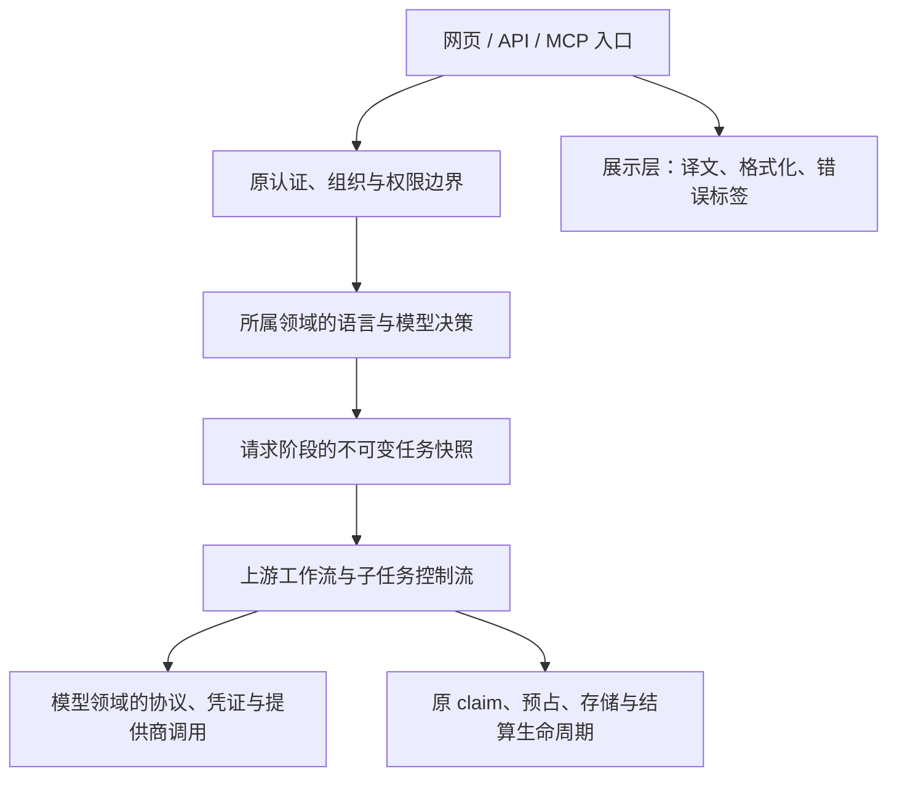

# P3 全量收敛设计

日期：2026-11-09。状态：全量范围与职责设计已建立，后续结构实施按本设计推进；P3 整体尚未完成，P4 未开始。本文件把四个试点之后的工作重新放回整个 fork 的长期维护目标，不按某次上游冲突列表取范围。

## 1. 问题与目标

当前二开在上游组件、请求准备、模型解析和任务传播中都有接入。此前四批分别处理了上下文候选、API 分类、单镜头报价及翻译维护报告，解决的是局部问题。它们没有让既有修改路径或同一上游样本的冲突文件减少，不能据此认定整体升级成本已经下降。

本轮目标是让全部长期差异都有可验证的职责和处置：可以沿用上游的恢复上游；二开决策集中在所属领域；必须接入原流程的保留最小桥接，并明确边界契约和以后升级时核对的内容。恢复原行为、结构提取和未来商业改造分别记录。

国际化本身会触及大量上游组件，必要的 `t()` 或格式化调用可能长期存在。P3 不能承诺零冲突，也不能据此批量批准所有文案差异。每处接入仍须核对是否夹带业务逻辑、复制上游实现或重复策略。文件移动和新增 helper 本身不算收益。

## 2. 固定范围及来源

| 对象              | 本轮固定值                                                                           |
| ----------------- | ------------------------------------------------------------------------------------ |
| 已合入上游基线 B  | `2f38e52c1548708b8a6ba30fb9c0d01cdd3896a0`                                           |
| 当前源码快照 S    | `db3ea57b5f419f69c51369c28819de17515b21f5`                                           |
| P2 历史审查源码 P | `ce321c885f67e40fec1c8598bb759790d89359c9`                                           |
| B→S 全部路径      | 1,219：653 修改、566 新增                                                            |
| src               | 606 既有修改、411 新增                                                               |
| 其他目录          | 202 路径                                                                             |
| P2 范围关联       | 1,128 仍在；另增 91；旧范围内 27 再次变化                                            |
| 历史来源          | 净路径关联 78 个旧行为编号，结合历史来源共 79 个；277 个合并路径对、7 个历史独有路径 |

完整路径与 B/P/S 指纹、分片校验和、复核命令见[范围证据](preservation/20261109-p3-global-design/README.md)及 [scope.json](preservation/20261109-p3-global-design/scope.json)。分母独立于待合入上游；新增模块、测试、工具和文档全部在内。之后的实施作为 S 之后的交付增量追加。

所有路径的 `p3Disposition` 初始为 `pending`。P2 历史结论只提供来源；本轮路径扫描、历史编号映射和职责设计均不冒充逐块语义审查或生产行为验收。现有 `src/routeTree.gen.ts` 工作区改动单列保护。

此前四批前后对照及同一上游样本的 18 个冲突归档在 [prior-pilot-comparison.json](preservation/20261109-p3-global-design/prior-pilot-comparison.json)。该样本是收益反证，不是治理范围，也没有在本轮重新运行或合入。

## 3. 目标职责边界

下图表示职责关系，复用当前领域模块和现有接口；不是一套已实现的新插件框架。

| 设计领域       | 当前核对范围与目标                                                               | 详细设计                                                                                   |
| -------------- | -------------------------------------------------------------------------------- | ------------------------------------------------------------------------------------------ |
| 展示与语言     | locale/SSR、资源、界面/帮助/邮件、格式化、错误展示、Studio 与 MCP 展示的异步边界 | [presentation-language](preservation/20261109-p3-global-design/presentation-language.md)   |
| 模型配置与渠道 | 管理员配置、默认模型、内置/自定义渠道、协议、规格、报价、凭证来源                | [model-channels](preservation/20261109-p3-global-design/model-channels.md)                 |
| 生成与工作流   | 请求→任务→子任务、系统指令/风格、准备与执行、claim/结算/存储及 staleness         | [generation-context](preservation/20261109-p3-global-design/generation-context.md)         |
| 认证与公共入口 | 组织/session、Assistant、API/MCP、工具恢复、数据库与运行边界、Windows 兼容       | [application-boundaries](preservation/20261109-p3-global-design/application-boundaries.md) |

同一旧行为编号或文件可以关联多个职责。跨组共享输入输出契约，不接管对方的执行生命周期。新增职责优先放回所属领域，不因想隔离二开就移动到 domain-blind 的 platform。

## 4. 跨职责契约

1. **身份与语言分开。** 上游 principal、组织选择与角色检查仍是资源访问依据。网页语言通过当前 locale 接口进入实际渲染与任务；不能把系统指令语言当授权条件，外部 API/MCP 的既有兼容规则单列核对。
2. **模型决策与执行分开。** 管理员配置和渠道选择在请求准备阶段确定，任务携带当前实际支持的快照与引用。提供商执行读取该快照；不在任务运行中重选默认模型或渠道，不静默跨渠道回退。
3. **快照与秘密分开。** 快照保存现有允许的配置、路由与凭证引用，实际秘密依原 credentials hatch 在支出步骤解析；不把明文密钥放入任务或回显，不借结构改造改变轮换和失效策略。
4. **报价与提交共享同一准备结果。** 模型领域定义规格与报价含义，生成入口负责本次实际参考资产和所需输入；校验、预占、claim、提交、失败释放、扣费仍由原生命周期拥有。不能用一个通用 reservation 抹平不同契约。
5. **文案与业务值分开。** 展示层只翻译消息和格式化已有值，不改用户原文、提供商协议、错误类别、计费单位及实际金额。系统指令按任务语言选独立资源。
6. **调用入口与领域能力分开。** 网页、Assistant、API/MCP 复用现有领域服务和工具能力；入口只适配其真实身份、参数与返回格式，不再各实现一套模型或权限决策。
7. **配置与内容所有权分开。** 组织角色、角色 look、地点、风格以及生成快照沿用真实所有权、claim 和 staleness；结构整理不改变用户可见的选择、覆盖或共享行为。

以上是待逐批落实和验证的契约。各设计中拟新增的模块或导出明确标为拟建，不能当作现有公开 API 调用。

## 5. 实施规则与停止条件

每批从当前源码重新确认该职责的全部调用入口，并把同文件内的其他职责列为保留项。先记上游原行为、当前差异与具体重复，再选择恢复上游、领域策略加薄桥接，或有证据地保留最小局部修改。

- 实施前固定 before SHA；列出涉及路径、差异块、真实调用链、原断言和外部行为。
- 一次只提取一个职责；边界变化时先改拥有该职责的模块，再让完整调用集合消费同一来源。
- 不复制上游核心到扩展目录，不造万能 context，不用运行时 DOM 替换，不为减少 diff 改写数据库、任务兼容或提供商行为。
- 如果提取仅移动重复、扩大核心接入、迫使调用者传大量无关上下文，停止该方案并留下依据。保留现状是合法处置，但不能记作已经减少侵入。
- 发现真实业务回归时单列修复及证据；不混入人民币定价、全面禁止 BYOK、默认私有或已取消的个人钱包/卡密改造。
- 用户暂缓的 `CONTINUE-LLM-SOURCE` 继续单列；结构批次不借机修复它，也不把它标成已关闭。

## 6. 每批证据与全量完成判据

每批交付：before/after SHA；全部入口对照；实际删除的重复决策/恢复的上游差异；剩余最小桥接及原因；原测试断言追溯；定向验证与未验证边界；新增、改名、退出及仍待审的路径。新增文件也需说明是否拥有二开职责，不能把复制核心计为隔离成果。

按风险选择当前验证：语言首屏与异步、模型/协议/凭证来源、请求/任务/子任务一致性、完整生成生命周期、组织及外部 principal、真实本地运行边界。源码/工具变动运行对应正常检查；纯文档与数据证据不重跑无关生成测试。所有付费调用、真实邮件、远程数据库和部署继续独立授权。

P3 完成须同时满足：

1. 全部当前差异块及新增模块已有可追溯处置，职责和跨职责依赖全部关闭；没有未经解释的 pending。
2. 可删除的二开决策和可恢复上游的差异已实际处理，剩余接入均有最小性依据，不能按目录集体认定必要。
3. 原上游执行骨架、外部行为和原断言得到保留或等效迁移，有对应版本的验证；历史测试数量不代替本轮证据。
4. 能证明维护负担如何变化，包含重复决策来源、剩余语义差异与必要调用；路径数和单次冲突数仅作辅助。
5. 暂缓、待验证和未来商业功能有清晰边界；不能将全量设计完成写成全量整改完成。

## 7. 全局职责、批次与真实依赖

四组共59项产品/工程职责，加1项治理职责；映射覆盖79个历史行为编号及全部1,219个固定源码路径。共有66项结构候选、当前验证或未来触发复核动作，**不是66项已批准修改，更不是已经完成的整改**。机器索引见 [roadmap.json](preservation/20261109-p3-global-design/roadmap.json)，每项具体范围/依赖/验收见其批次明细。

| 工作线         | 入口与后续范围                                                                                    | 依赖及结束条件                                                                         |
| -------------- | ------------------------------------------------------------------------------------------------- | -------------------------------------------------------------------------------------- |
| 第一实施批     | G09-reference-projection：统一 cast sheet 真实输入到 direct/plan 报价的投影                       | 复核当前图片 quote 契约；不改组织所有权、队列校验、claim、资金或生成控制流             |
| 生成计划费用   | G09 后顺序做 G07-partition，再核对 G07-callers 全部入口（仅现有快照契约）；G06/G14 独立准备       | G09/G07 涉及同 billing 文件须顺序；未知价、floor、mixed model、有效规格和父子快照保持  |
| 独立模型规则   | MC-B01 完整图片请求能力；MC-B02 配置文本成本；MC-B03 图片钱包精度                                 | 各批独立、每次一个职责；不等待新通用 resolver，不修改原生/fal 恢复或账本               |
| 展示与语言     | PL-B01～13 覆盖 locale/head、完整资源消费者、全部用户流、错误/异步、邮件/帮助、Studio/助手/stitch | 按实际依赖推进；G04 按单个 builder 整理指令资源，全文语义另验；PL-B14 最后核对全部处置 |
| 认证与公共入口 | AB-01～13 核对身份、会话、locale、API/MCP/助手、工具审批与恢复、ScopedDb                          | 沿用 X-* 现有接口；AB-06/13 保留薄组合，AB-07 仅在证明同义后提取                       |
| 工程与暂留补丁 | AB-14～22 逐项核对边界、双平台、隔离、preview、依赖及生成噪声                                     | 当前必要性需当前证据；X-UPGRADE 记录未来退出条件，不等待未知上游版本才能完成 P3        |
| 全量收尾       | GOV-01、PL-B14 与各职责的原断言/生命周期验证                                                      | 逐块处置全部当前差异，核对新增与退出；剩余必要接入有依据，不能按目录批准               |

上表是工作线与优先级，不强制所有工作线串行。66项动作的具体内部依赖已经无环核对；跨组 gate 是当前接口复核交接点，不是新增运行时接口。AB21-b 的现有报告/Storybook 验证属于当前 P3，不等待 CI。X-FUTURE-CI 属 P4，当前不接入 CI；未来升级触发项不能成为永久暂留依据，也不隐含远程/付费验收授权。

集成已裁决两处不做形式提取：`loadModelRuntimeConfiguration`（scoped.ts:563）约14行已有 composition root，`assistantRequestModel`（assistant-chat.ts:289）约19行聊天专用组合，均保留当前 owner，不把搬移计收益。网页默认值带模式、比例及保存偏好，API 默认值不能仅因配置/凭证相同就强行统一；具体依据见公共入口设计。

[历史编号映射](preservation/20261109-p3-global-design/behavior-responsibilities.jsonl) 与 [91个补充路径映射](preservation/20261109-p3-global-design/scope-additions-responsibilities.jsonl) 让固定范围没有归属提示孤项；二者都保留待语义处置状态。原始 inventory 仍有1,219项 pending；路由完整不代表实际修改、原断言与验收闭合。

## 8. 本次交付状态

本次完成全量设计、来源/指纹、职责与依赖映射，以及 P3 状态纠正；没有修改应用运行源码。四个历史试点按各自已记录结果保留，当前新增结构批次仍待实施。范围、格式、链接与依赖机械检查见 [交付验证](preservation/20261109-p3-global-design/verification.json)，不作为模型、Workflows 引擎或线上行为验收。
